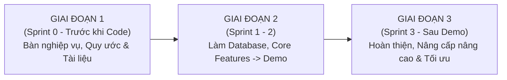

# BẢNG PHÂN CÔNG CÔNG VIỆC THÀNH VIÊN DỰ ÁN MINI-WMS (PEEP2026)

> **Dự án:** Hệ thống Quản trị Kho Hàng Thông Minh (Mini-WMS - PEEP2026)  
> **Người lập:** Nhóm trưởng (Team Leader)  
> **Ngày lập:** 15/10/2026  
> **Thành viên :**  
> 1. **Nam Nguyen** - Backend Developer  
> 2. **Thuan Le** - Backend Developer  
> 3. **Trung Pham** - Backend Developer + Leader  
> 4. **Vy Tran** - Frontend UI/UX Lead  

---

## I. TỔNG QUAN PHÂN VAI & ĐỘI NGŨ THỰC HIỆN

Dự án Mini-WMS được phát triển bởi đội ngũ 4 thành viên chủ lực (3 Backend + 1 Frontend). Để phát huy tối đa năng lực cá nhân và đảm bảo hệ thống vận hành thông suốt qua các đợt Demo, công việc được phân định rõ ràng:

- **Trung Pham (Team Leader & Backend Developer):** Là Nhóm trưởng dự án kiêm Backend Developer.
  + **Nhiệm vụ Quản trị & Điều phối (Leader):** Chủ trì lấy ý kiến cả nhóm về thiết kế và xây dựng web; lập kế hoạch tổng thể (Plan) và phân công công việc chi tiết cho từng thành viên theo từng tuần/sprint; rà soát, đối soát kết quả công việc (review code, API, CSDL) của các thành viên; và trực tiếp thực hiện kiểm thử thủ công (Manual Testing).
  + **Nhiệm vụ Kỹ thuật (Backend):** Phụ trách Danh mục Master Data (Kho, Vị trí, Đơn vị tính, Sản phẩm), Quản lý Nhà cung cấp, Cơ chế Bút toán đảo an toàn (`Reversal`), Bảo mật/RBAC Patch, Cảnh báo hạn sử dụng và Hệ thống API Dashboard tổng quan phân nhánh theo 5 Role.
- **Thuan Le:** Phụ trách thiết lập Cơ sở dữ liệu nền tảng, thiết kế Core Sổ cái tồn kho (`InventoryLedgerService`), phân hệ Chuyển kho nội bộ (`Transfer`), Nhập kho đa vị trí và Thuật toán kiểm soát sức chứa phân cấp (`Capacity Hierarchy`).
- **Nam Nguyen:** Phụ trách phân hệ Xác thực & Phân quyền người dùng (Auth & RBAC), Luồng Nhập kho ban đầu (`Inbound / Putaway`), Luồng Xuất kho hoàn chỉnh (`Shipment / Dispatch`), và Module Hàng hoàn trả (`Returns / RMA`).
- **Vy Tran:** Phụ trách toàn diện phần Frontend (UI/UX), đảm bảo xây dựng hệ thống giao diện trực quan, đồng bộ và kết nối API liền mạch cho tất cả các luồng vận hành từ máy tính quản lý đến thiết bị thao tác tại kho.

---

## II. CHI TIẾT PHÂN CÔNG CÔNG VIỆC THEO 3 GIAI ĐOẠN

---

### GIAI ĐOẠN 1: NGHIÊN CỨU NGHIỆP VỤ, LẬP KẾ HOẠCH & XÂY DỰNG TÀI LIỆU
*(Thời gian: Sprint 0 - Giai đoạn tiền triển khai)*

#### 1. Mục tiêu giai đoạn:
- Thống nhất toàn bộ quy ước kỹ thuật chung: chuẩn đặt tên bảng/cột (`snake_case`, số nhiều, khóa chính UUID), quy ước kiểu dữ liệu (`DECIMAL(18,4)` cho số lượng, `TIMESTAMP UTC`), quy ước các cột audit bắt buộc (`created_at`, `created_by`, `updated_at`, `updated_by`), và nguyên tắc xóa mềm (`status` / `is_active`).
- Định hình 7 vai trò người dùng trong kho: **System Admin, WH Manager, Supervisor, Receiver, Picker, Inspector, Viewer**.
- Bóc tách toàn bộ hệ thống WMS thành 5 Domain nghiệp vụ để làm tài liệu thiết kế CSDL (ERD bằng PlantUML) và luồng hoạt động (Business Flow).

#### 2. Phân công chi tiết từng thành viên trong Giai đoạn 1:

| Thành viên | Domain / Nhiệm vụ phụ trách | Chi tiết công việc thực hiện | Sản phẩm bàn giao (Deliverables) |
| :--- | :--- | :--- | :--- |
| **Trung Pham** | **Team Leader** & **Domain C — Product & Supplier** | - **Nhiệm vụ Leader:** Chủ trì các buổi họp khảo sát, lấy ý kiến cả nhóm về luồng nghiệp vụ và định hướng kiến trúc web; lập tài liệu kế hoạch tổng thể (Sprint 0 Plan), phân chia 5 Domain cho từng thành viên; rà soát, đối soát và hợp nhất tài liệu ERD, Data Dictionary, Business Rules chung. - **Nhiệm vụ Domain C:** Phân tích quản lý danh mục Hàng hóa (SKU), Đơn vị tính cơ bản (`base_uom`), Bảng tỷ lệ quy đổi đơn vị (`sku_uom_conversions`). - Phân tích cấu trúc quản lý Nhà cung cấp (Suppliers), liên kết sản phẩm phân phối (`sku_suppliers`) và mã vạch (`sku_barcodes`). - Đưa ra các thuộc tính kiểm soát: `is_lot_tracked`, `is_serial_tracked`, trọng lượng, thể tích sản phẩm. | - Bản kế hoạch phân công công việc & Quy ước làm việc nhóm (`Quy ước.docx`). - Tài liệu & ERD Domain C (`skus`, `uoms`, `sku_uom_conversions`, `suppliers`, `sku_suppliers`, `sku_barcodes`). - Tài liệu quy tắc nghiệp vụ quy đổi đơn vị đo lường. |
| **Nam Nguyen** | **Domain A — Authentication & RBAC** & **Domain E — Stock Ledger & Movement** | - Phân tích cấu trúc bảng Quản lý User, Role, Permission và cơ chế phân quyền theo phạm vi Kho hàng (`warehouse_id`). - Thiết kế tài liệu phân loại các loại giao dịch kho (`movement_type_code`: RECEIPT, SHIPMENT, TRANSFER, ADJUST...). - Xây dựng nguyên tắc sổ cái `stock_ledger` bất biến (Append-only). | - Tài liệu & ERD Domain A (`users`, `roles`, `permissions`, `user_roles`). - Tài liệu & ERD Domain E (`stock_ledger`, `movement_types`). |
| **Vy Tran** | **Domain B — Warehouse Structure** | - Phân tích cấu trúc phân cấp vật lý của kho hàng theo mô hình cây: Kho tổng (Warehouse) $\rightarrow$ Khu vực (Zone) $\rightarrow$ Dãy (Aisle) $\rightarrow$ Kệ (Rack) $\rightarrow$ Ô lưu trữ (Bin). - Phân loại mục đích sử dụng của vị trí (`purpose`: STORAGE, RECEIVING, STAGING, QC, DAMAGED) và cờ lấy hàng (`is_pickable`). | - Tài liệu & ERD Domain B (`warehouses`, `locations`). - Quy chuẩn phân cấp mã vị trí kho (Location hierarchy & Barcode scheme). |
| **Thuan Le** | **Domain D — Inventory Model** | - Phân tích mô hình quản lý số lượng tồn kho theo khóa Unique tổ hợp: `(warehouse_id, location_id, sku_id, lot_no, serial_no)`. - Xây dựng công thức tồn kho bất biến: `qty_available = qty_on_hand - qty_reserved`. - Phân tích cơ chế Khóa dữ liệu (Locking) và tính toàn vẹn (ACID Transaction) khi phát sinh thay đổi tồn kho. | - Tài liệu & ERD Domain D (`inventory`). - Tài liệu đặc tả toán học và ràng buộc toàn vẹn dữ liệu tồn kho. |
| **Cả nhóm (Phối hợp)** | **Quy ước chung & Business Flow** | - Thống nhất sơ đồ tổng thể `ERD_Master.puml` tích hợp cả 5 Domain. - Thống nhất quy trình vận hành liên vai trò (Activity Diagram/Swimlane) cho 7 Roles. | - File tài liệu `Quy ước.docx`. - File `Bussiness_flow.puml` và sơ đồ lưu đồ chung. |

---

### GIAI ĐOẠN 2: TỪ LÚC LÀM DATABASE ĐẾN LÚC DEMO
*(Thời gian: Sprint 1 & Sprint 2 - Tuần 2, Tuần 3 và Chặng đầu Tuần 4)*

#### 1. Mục tiêu giai đoạn:
- Hiện thực hóa thiết kế từ Giai đoạn 1 thành CSDL PostgreSQL thông qua Prisma ORM; viết seed data mẫu ban đầu.
- Xây dựng "trái tim" hệ thống: `InventoryLedgerService` - service ghi nhận biến động tồn kho bất biến.
- Triển khai toàn bộ các module nền tảng: Đăng nhập/Phân quyền, Master Data (Kho, Vị trí, UOM, SKU), Quản lý Nhà cung cấp.
- Vận hành các luồng nghiệp vụ cốt lõi: Nhập hàng (Inbound), Cất hàng (Putaway), Kiểm kê (Cycle Count), Điều chỉnh có phê duyệt (Adjustment), và chuẩn bị nền móng cho Xuất kho (Shipment) & Chuyển kho (Transfer).
- Hoàn thành giao diện người dùng tương ứng cho từng vai trò và tổ chức Demo thành công.

#### 2. Phân công chi tiết từng thành viên trong Giai đoạn 2:

| Thành viên | Phân hệ / Module phụ trách | Chi tiết công việc thực hiện (Backend / Frontend) |
| :--- | :--- | :--- |
| **Trung Pham** | **Team Leader (Lập Plan, Rà soát, Kiểm thử thủ công) & Master Data, NCC, Bút toán đảo** | **Nhiệm vụ Leader:** - Lập kế hoạch chi tiết Tuần 2, Tuần 3, Tuần 4 (`plan_week2.md`, `plan_week3.md`, `plan_week4.md`) và phân bổ đầu việc rõ ràng cho từng thành viên. - Lắng nghe phản hồi từ các bạn, điều chỉnh yêu cầu kỹ thuật để tối ưu hóa tiến độ. - Thường xuyên rà soát kết quả code, đối soát API và cấu trúc CSDL của các thành viên trước khi tích hợp. - **Trực tiếp kiểm thử thủ công (Manual Testing):** Test từng tính năng trên giao diện web (tạo tài khoản, tạo kho/vị trí, nhập hàng, kiểm kê, giữ chỗ xuất hàng) để phát hiện bug logic và trải nghiệm trước khi Demo. **Nhiệm vụ Backend:** - **Tuần 2:** Phát triển toàn bộ API Quản lý Kho hàng (`/api/warehouses`), API Cây vị trí kho (`/api/locations`), API Đơn vị tính (`/api/uoms`), và API Danh mục Sản phẩm (`/api/skus` & quy đổi đơn vị tính). - **Tuần 3:** Xây dựng toàn bộ phân hệ Quản lý Nhà cung cấp & Đối tác (`/api/suppliers`): Thêm, sửa, xóa, tìm kiếm nhà cung cấp; API gán mã SKU của nhà cung cấp (`/api/suppliers/{id}/skus`). - **Tuần 4:** Phát triển phân hệ Bút toán đảo (`Reversal`: `/api/reversals/requests`) gồm tạo yêu cầu đảo từ dòng thẻ kho sai và luồng trình Admin duyệt. Xây dựng API Điều chỉnh nhanh (`Quick Adjustment`) từ UI tồn kho với cơ chế `inventoryVersion` kiểm soát xung đột (Optimistic Lock chặn 409). |
| **Thuan Le** | **Database, Core Ledger, Kiểm kê & Mã QR, Chuyển kho (nền móng)** | **Tuần 2:** Cấu hình kết nối DB PostgreSQL, Prisma Client, viết script `seed` khởi tạo user `admin`, danh sách Roles chuẩn và kho mẫu. - Trực tiếp xây dựng `InventoryLedgerService` (`StockLedgerService`) xử lý mọi biến động tồn kho qua Transaction, Append-only (cấm UPDATE/DELETE `stock_ledger`), và cơ chế Lock chống chạy trùng (Concurrency). - Xây dựng API tra cứu tồn kho `/api/inventory` và lịch sử thẻ kho `/api/stock-ledger`. **Tuần 3:** Xây dựng API Phân hệ Kiểm kê (`Cycle Count`: `/api/cycle-counts`) gồm tạo đợt kiểm kê theo vị trí/kho và nộp kết quả đếm thực tế. - Xây dựng API truy xuất thông tin in Mã QR hàng hóa (`/api/qrcodes/sku/.../uom/...`). **Tuần 4:** Thiết kế cấu trúc CSDL và viết API Chuyển kho liên trạm (`/api/transfers`) qua kho trung gian ảo `TRANSIT`. |
| **Nam Nguyen** | **Xác thực & Người dùng, Nhập kho Inbound & Putaway, Xuất kho (nền móng)** | **Tuần 2:** Xây dựng toàn bộ phân hệ Xác thực: API Login (`POST /api/auth/login`), Lấy thông tin cá nhân (`GET /api/auth/me`), CRUD Người dùng (`/api/users`), và API Gán quyền theo kho (`POST /api/users/{id}/roles`). **Tuần 3:** Phát triển toàn bộ phân hệ Nhập hàng & Cất hàng (`Inbound / Putaway`: `/api/receipts`) bao gồm: Tạo phiếu nhập (Supervisor assign Receiver), Xác nhận nhận hàng và cất hàng vào kệ (Receiver). Xử lý chặt chẽ Transaction liên kết `receipt_lines`, `inventory`, `stock_ledger` và cập nhật thông tin Lô/Hạn sử dụng. - Phát triển API đề xuất Điều chỉnh tồn kho (`/api/adjustments`) và API duyệt điều chỉnh. **Tuần 4:** Xây dựng nền tảng luồng Xuất kho (`Shipment`: `/api/shipments`), thuật toán Gợi ý FEFO (`/api/shipments/{id}/fefo-suggestions`), API Khóa tồn kho (Reserve) và Soạn hàng sang khu `STAGING` (Pick). |
| **Vy Tran** | **Frontend UI/UX (Toàn bộ Giao diện Vận hành & Quản trị)** | **Tuần 2:** Thiết kế và code hoàn chỉnh 7 màn hình cơ bản: Đăng nhập (Login), Quản lý người dùng, Gán quyền Role theo kho, Danh sách Kho, Sơ đồ Vị trí kho phân cấp, Danh mục Hàng hóa (SKU List), Màn hình Chi tiết SKU & Quy đổi UOM. **Tuần 3:** Xây dựng giao diện phân vai cho luồng Nhập kho (Form Supervisor tạo phiếu/gán việc; Form Receiver nhận hàng, nhập Lot/Date, chọn vị trí cất). Xây dựng giao diện Kiểm kê (Giao việc cho Inspector, bảng nhập số đếm, nút tạo đề xuất lệch). Giao diện Quản lý Nhà cung cấp và Modal Popup hiển thị/in mã QR tem nhãn hàng hóa. **Tuần 4:** Xây dựng giao diện luồng Xuất kho (Chọn giữ chỗ FEFO, màn hình Picker lấy hàng, chuyển vào STAGING), Màn hình Chuyển kho (Tab Gửi đi / Nhận về cho Manager 2 đầu kho), Popup Điều chỉnh nhanh tại trang Tồn kho và Màn hình Bút toán đảo. |

---

### GIAI ĐOẠN 3: SAU DEMO, TỐI ƯU LẠI DỰ ÁN & MỞ RỘNG TỔNG KẾT
*(Thời gian: Sprint 3 - Tiếp tục Tuần 4 và hoàn thiện toàn diện theo Tuần 5)*

#### 1. Mục tiêu giai đoạn:
- **Tối ưu & Hoàn thiện luồng Outbound & Transfer:** Hoàn tất khâu Dispatch xuất kho cuối cùng, hỗ trợ xuất nhiều lần (giao thiếu `PARTIALLY_SHIPPED`), xử lý nhận chuyển kho bị lệch số lượng (`DISCREPANCY`).
- **Nâng cấp Luồng Nhập kho Đa vị trí (Multi-destination Inbound):** Xóa bỏ ràng buộc 1 dòng chỉ vào 1 ô; cho phép 1 dòng hàng nhập phân bổ linh hoạt vào nhiều ô (Ô lưu trữ `STORAGE`, Ô cách ly hàng hỏng `DAMAGED`, Ô nhận `RECEIVING`).
- **Kiểm soát Sức chứa Phân cấp (Hierarchical Capacity Control):** Quản lý tải trọng (`maxWeight` kg) và thể tích (`maxVolume` m³) theo cấu trúc hình tháp: $\text{Ô (Bin)} \le \text{Kệ (Rack)} \le \text{Dãy (Aisle)} \le \text{Khu (Zone)} \le \text{Kho tổng (Warehouse)}$. Tự động chặn nhập kho nếu vượt quá sức chứa.
- **Xây dựng Module Hàng hoàn trả (Returns / RMA):** Tiếp nhận hàng hoàn trả từ khách, cân thực tế đối chiếu vào khu cách ly (`QC`), phân công Inspector kiểm định chất lượng để Nhập lại kho (`RESTOCK`) hoặc Tiêu hủy (`SCRAP`).
- **Trung tâm Điều hành (Dashboard) theo 5 Role:** Xây dựng Dashboard cá nhân hóa theo vai trò: Manager (sức chứa, cảnh báo date, chờ duyệt), Supervisor (tiến độ ca trực, việc chưa gán), Operator (My Tasks cho Picker/Receiver), Inspector (kiểm kê, KCS hàng trả), Admin (sức khỏe hệ thống, User stats).
- **Tối ưu & An toàn hệ thống:** Soft Delete Guard (chặn xóa/vô hiệu hóa kho nếu còn tồn hàng), Reset Password Admin, Tự động sinh mã vạch SKU-UOM, Cảnh báo hạn sử dụng động.

#### 2. Phân công chi tiết từng thành viên trong Giai đoạn 3:

| Thành viên | Trọng tâm Phụ trách | Chi tiết công việc thực hiện (Backend / Frontend) |
| :--- | :--- | :--- |
| **Trung Pham** | **Team Leader (Điều phối, Rà soát, Kiểm thử E2E) & Bút toán đảo, Bảo mật/RBAC, Dashboard 5 Role** | **Nhiệm vụ Leader:** - Thu thập ý kiến phản hồi sau buổi Demo; rà soát các vấn đề phát sinh để xây dựng kế hoạch nâng cấp và tối ưu Tuần 5 (`plan_week5.md`). - Rà soát nghiệm thu kết quả các feature mới của các thành viên (Nhập kho đa vị trí, Sức chứa phân cấp, Returns RMA, UI Dashboard). - **Kiểm thử thủ công toàn diện (End-to-End Manual Testing):** Đóng vai trực tiếp cả 7 Roles (Admin, Manager, Supervisor, Receiver, Picker, Inspector, Viewer) để chạy thông suốt toàn bộ kịch bản thực tế từ Inbound $\rightarrow$ Outbound Dispatch $\rightarrow$ Chuyển kho $\rightarrow$ Kiểm kê $\rightarrow$ Trả hàng RMA; đối soát dữ liệu sổ cái `stock_ledger` đảm bảo hệ thống sẵn sàng 100% cho Demo Tổng kết. **Nhiệm vụ Backend:** - **Tiếp tục Tuần 4:** Hoàn thiện API duyệt Bút toán đảo (`/api/reversals/requests/{id}/approve`): Đóng gói thành hàm chuyên biệt `executeReversal(...)` trong `InventoryLedgerService`, kiểm tra nghiêm ngặt điều kiện 1 vế, chống âm kho. - **Tuần 5 (Security & RBAC):** Cập nhật enum mã quyền mới (`RETURN.*`, `DASHBOARD_READ`, `USER_RESET_PASSWORD`), cập nhật `permission-defaults.ts` và chạy Patch script cập nhật quyền vào CSDL. Viết API Reset Password cho Admin (`POST /api/users/{id}/reset-password`). - **Tuần 5 (Cảnh báo & Sơ đồ kho):** Bổ sung tính toán động `daysUntilExpiry` và cờ cảnh báo `expiryAlert` (`CRITICAL`, `WARNING`, `NORMAL`) trong API Tồn kho. Nâng cấp API Sơ đồ kho hỗ trợ lọc `status = 'ALL' | 'ACTIVE' | 'INACTIVE'` và API lấy cây cấu trúc `/locations/tree`. - **Tuần 5 (Dashboard Core):** Xây dựng bộ 5 API Dashboard tổng quan phân nhánh theo từng Role (Manager, Supervisor, Operator, Inspector, Admin). |
| **Nam Nguyen** | **Hoàn thiện Xuất kho Dispatch, Module Hàng hoàn trả (Returns / RMA) & Tự động sinh Barcode** | **Tiếp tục Tuần 4:** Hoàn thiện API Xuất kho - Dispatch (`POST /api/shipments/{id}/dispatch`): Lưu vết `shipment_dispatch_lines`, cơ chế chống spam click bằng `requestId` (Idempotency), xử lý chuyển trạng thái `PARTIALLY_SHIPPED` khi giao thiếu. **Tuần 5 (Module Returns):** Tạo các model Prisma `ReturnOrder`, `ReturnLine`. Viết trọn bộ API Hàng hoàn trả: + Tạo phiếu hoàn trả từ đơn xuất gốc (`POST /api/returns`). + Phân công nhân viên nhận hàng (`POST /api/returns/{id}/assign`). + Tiếp nhận cân thực tế tại cửa kho vào khu cách ly (`POST /api/returns/{id}/receive`): Bắt buộc nhận vào ô có `purpose = 'QC'` hoặc `'DAMAGED'`, ghi sổ cái loại `RETURN` cách ly không bán được. + Kiểm định chất lượng (`POST /api/returns/{id}/inspect`): Xử lý 2 nhánh `RESTOCK` (nhập lại ô bán) hoặc `SCRAP` (tiêu hủy). **Tuần 5 (Barcode):** Triển khai logic Backend tự động sinh mã vạch chuẩn `BAR-{skuCode}-{uomCode}` khi tạo mới quy đổi đơn vị tính. |
| **Thuan Le** | **Hoàn thiện Chuyển kho, Nhập kho Đa vị trí, Kiểm soát Sức chứa Phân cấp & Soft Delete Guard** | **Tiếp tục Tuần 4:** Hoàn tất API Nhận hàng chuyển kho (`POST /api/transfers/{id}/receive`): Cập nhật kho đích, xử lý trường hợp nhận thiếu sinh trạng thái `DISCREPANCY`, giữ hàng lơ lửng tại kho ảo `TRANSIT`. **Tuần 5 (Multi-destination Inbound):** Bổ sung model `ReceiptLineDetail`. Tái cấu trúc API Nhập kho (`POST /api/receipts/{id}/receive`) cho phép 1 dòng nhập phân bổ thành nhiều dòng con (`allocations`) vào các ô khác nhau (Ô lưu trữ, Ô hàng hỏng cách ly). **Tuần 5 (Capacity Control):** Thêm trường `maxWeight` và `maxVolume` vào `Warehouse`. Lập trình thuật toán kiểm soát dung lượng phân cấp hình tháp: $\sum \text{con} \le \text{giới hạn cha}$ ở mọi tầng. Chặn ném lỗi `400` nếu hàng nhập làm vượt sức chứa của ô/kho. **Tuần 5 (Soft Delete Guard):** Bổ sung cơ chế bảo vệ an toàn kho tại `DELETE /api/warehouses/:id` và `PUT /api/warehouses/:id` (khi đổi `status: 'INACTIVE'`). Chặn và ném lỗi `400 Bad Request` nếu trong kho còn bất kỳ mặt hàng nào có `qtyOnHand > 0`. |
| **Vy Tran** | **Frontend UI/UX Lead (Toàn bộ Giao diện Nâng cấp, Dashboard & Tối ưu Trải nghiệm)** | **Tiếp tục Tuần 4:** Hoàn thiện giao diện Dispatch xuất kho cho Picker/Dispatcher; Giao diện xác nhận nhận chuyển kho kèm hiển thị trạng thái lệch thừa/thiếu (`DISCREPANCY`); Màn hình duyệt Bút toán đảo cho Admin. **Tuần 5 (Giao diện Nhập kho Đa vị trí):** Nâng cấp trang Receipt Detail: Bổ sung nút "+ Thêm vị trí nhận", cho phép người nhận chọn nhiều ô (Lưu trữ / Hàng hỏng) và điền số lượng phân bổ trực quan. **Tuần 5 (Giao diện Returns / RMA):** Xây dựng trọn bộ màn hình Hàng hoàn trả: Trang danh sách phiếu trả, Form tiếp nhận cân hàng thực tế tại cửa kho, và Giao diện cho Inspector duyệt kiểm định chất lượng (Restock / Scrap). **Tuần 5 (Giao diện Dashboard 5 Role):** Xây dựng trang Dashboard tổng quan tự động thay đổi Layout và Widget theo Role đăng nhập (Thanh đo sức chứa % cho Manager, Thẻ tiến độ ca cho Supervisor, Bảng việc cần làm cho Operator). **Tuần 5 (Tính năng bổ trợ):** Thêm bộ lọc Active/Inactive và Tree View trong Sơ đồ vị trí; Gắn Badge màu cảnh báo hạn dùng (Đỏ = Hết hạn, Vàng = Cận hạn $\le$ 7 ngày) trong bảng Tồn kho; Modal Reset Password cho Admin; Popup cảnh báo chặn xóa kho an toàn khi kho còn hàng tồn. |

---

## III. BẢNG MA TRẬN PHÂN CÔNG TỔNG HỢP THEO TÍNH NĂNG (FEATURE MATRIX)

| STT | Phân hệ / Feature | Giai đoạn | Backend Lead | Frontend Lead | Trạng thái Nghiệm thu |
| :---: | :--- | :---: | :---: | :---: | :---: |
| **0** | **Quản trị Dự án: Lập Plan, Phân công việc, Lấy ý kiến & Kiểm thử thủ công** | **Xuyên suốt GĐ 1, 2, 3** | **Trung Pham (Leader)** | **Vy Tran (Phối hợp)** | **Hoàn thành** |
| **1** | Quy ước chung, Thiết kế ERD & Business Flow | Giai đoạn 1 | Thuan Le, Nam Nguyen, Trung Pham | Vy Tran | Hoàn thành |
| **2** | Đăng nhập, Quản lý User & Phân quyền RBAC | Giai đoạn 2 | Nam Nguyen | Vy Tran | Hoàn thành |
| **3** | Master Data: Kho, Vị trí, Đơn vị tính (UOM), Sản phẩm (SKU) | Giai đoạn 2 | Trung Pham | Vy Tran | Hoàn thành |
| **4** | Core Sổ cái Tồn kho (`InventoryLedgerService`) & Tra cứu Tồn | Giai đoạn 2 | Thuan Le | Vy Tran | Hoàn thành |
| **5** | Nhập hàng cơ bản & Cất hàng (Inbound / Putaway) | Giai đoạn 2 | Nam Nguyen | Vy Tran | Hoàn thành |
| **6** | Quản lý Nhà cung cấp & Đối tác (Suppliers) | Giai đoạn 2 | Trung Pham | Vy Tran | Hoàn thành |
| **7** | Kiểm kê (Cycle Count) & Đề xuất điều chỉnh tồn kho | Giai đoạn 2 | Thuan Le | Vy Tran | Hoàn thành |
| **8** | Mã QR Code cho Tem nhãn hàng hóa (SKU & UOM) | Giai đoạn 2 | Thuan Le | Vy Tran | Hoàn thành |
| **9** | Xuất kho (Shipment): Giữ chỗ FEFO & Soạn hàng vào STAGING | Giai đoạn 2 $\rightarrow$ 3 | Nam Nguyen | Vy Tran | Hoàn thành |
| **10** | Chuyển kho nội bộ (Transfer) qua kho trung gian TRANSIT | Giai đoạn 2 $\rightarrow$ 3 | Thuan Le | Vy Tran | Hoàn thành |
| **11** | Bút toán đảo (Reversal) an toàn & Điều chỉnh nhanh (Snapshot 409) | Giai đoạn 2 $\rightarrow$ 3 | Trung Pham | Vy Tran | Hoàn thành |
| **12** | Xuất kho Dispatch trực tiếp cho Picker & Xử lý Giao thiếu | Giai đoạn 3 | Nam Nguyen | Vy Tran | Hoàn thành |
| **13** | Nhập kho Đa vị trí (`ReceiptLineDetail`: STORAGE, QC, DAMAGED) | Giai đoạn 3 | Thuan Le | Vy Tran | Hoàn thành |
| **14** | Kiểm soát Sức chứa Phân cấp 5 tầng (Capacity Hierarchy) | Giai đoạn 3 | Thuan Le | Vy Tran | Hoàn thành |
| **15** | Bảo vệ an toàn khi Xóa mềm Kho (Soft Delete Guard) | Giai đoạn 3 | Thuan Le | Vy Tran | Hoàn thành |
| **16** | Module Hàng hoàn trả (Returns / RMA) & Kiểm định KCS | Giai đoạn 3 | Nam Nguyen | Vy Tran | Hoàn thành |
| **17** | Tự động sinh Mã vạch SKU-UOM tại Backend | Giai đoạn 3 | Nam Nguyen | *(Auto API)* | Hoàn thành |
| **18** | Cảnh báo Cận date động & Lọc Sơ đồ kho Active/Inactive/Tree | Giai đoạn 3 | Trung Pham | Vy Tran | Hoàn thành |
| **19** | Reset Password cho Admin & DB RBAC Patch | Giai đoạn 3 | Trung Pham | Vy Tran | Hoàn thành |
| **20** | Trang Tổng quan (Dashboard) đa phân vai theo 5 Role | Giai đoạn 3 | Trung Pham | Vy Tran | Hoàn thành |
